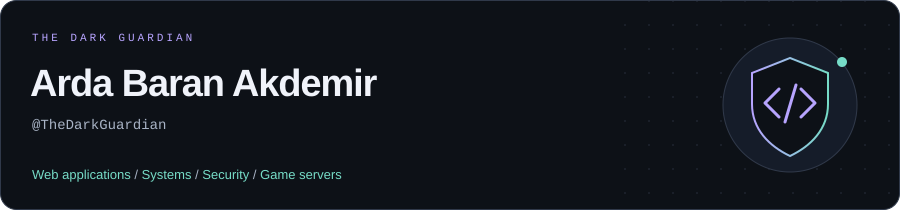
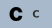
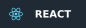
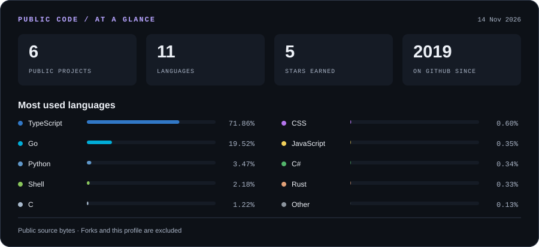

<picture>
  <source media="(prefers-color-scheme: dark)" srcset="assets/banner-dark.svg">
  <source media="(prefers-color-scheme: light)" srcset="assets/banner-light.svg">
  
</picture>

I build web applications, developer tools, security projects and game server utilities.
From React interfaces to Go services, Rust desktop apps and C# plugins.

### 🛠️ Technologies

**Languages**

  
  
  
  
  
  
  
  
  
  
  

**Frameworks & runtime**

  
  
  
  
  
  

**Data, infrastructure & tools**

  
  
  
  
  
  
  
  

### 📊 Code snapshot

<picture>
  <source media="(prefers-color-scheme: dark)" srcset="assets/stats-dark.svg">
  <source media="(prefers-color-scheme: light)" srcset="assets/stats-light.svg">
  
</picture>

Language percentages reflect code size in public repositories, not coding time. Forks and this profile repository are excluded.

### 🚀 Selected projects

| Project | What I'm building |
| :--- | :--- |
| [**WireWall**](https://github.com/TheDarkGuardian/WireWall) | An eBPF/XDP + nftables firewall with a Go control plane, React dashboard and Grafana monitoring. |
| [**DetectHub**](https://github.com/TheDarkGuardian/DetectHub) | A digital forensics and computer integrity platform built with Next.js, Tauri and Rust. |
| [**Tactical Control**](https://github.com/TheDarkGuardian/cs2-tactical-gamepanel) | A CS2 / CS:GO server management panel with TypeScript, WebSockets, Prisma and RCON. |
| [**Dispatch**](https://github.com/TheDarkGuardian/Dispatch) | A C# / .NET CounterStrikeSharp plugin for archiving and exporting CS2 plugin folders. |

Also exploring [AI developer workspaces](https://github.com/TheDarkGuardian/ai-command-center) and [AI-assisted navigation](https://github.com/TheDarkGuardian/RoadPilot-AI).

---

Web interfaces. System tools. Things that work together.

